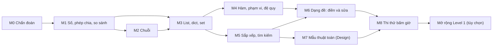

# Lộ trình Python Master - Bảng B (phiên bản 2, cập nhật 2026-10-10)

> Học xong lộ trình này, bạn đọc, điền, sửa và tự viết được hàm `solution` theo dạng đề COS Pro trong 50 phút, đạt ổn định từ 800/1000 trên đề thi thử Level 2, và có nền để thử Level 1 (90 phút). File này nằm tại `Python_Master/Roadmaps/ROADMAP.md`. Nguồn sự thật (source of truth: nơi quyết định khi tài liệu mâu thuẫn): tiến độ lấy từ `cham_diem.py`, `tien_do.json` và git log của repo `Python_Master`; thông tin kỳ thi lấy từ file trong thư mục và các trang ở mục 10, điều gì chưa kiểm chứng được ghi "(chưa xác minh)".

## Mục lục

1. [Cách dùng lộ trình này](#1-cách-dùng-lộ-trình-này)
2. [Bức tranh toàn cảnh](#2-bức-tranh-toàn-cảnh)
3. [Trạng thái hiện tại và lịch](#3-trạng-thái-hiện-tại-và-lịch)
4. [Các module](#4-các-module) (M0-M8)
5. [Ôn tập giãn cách và ôn xen kẽ](#5-ôn-tập-giãn-cách-và-ôn-xen-kẽ)
6. [Dự án tổng hợp](#6-dự-án-tổng-hợp)
7. [Sổ lỗi và cách hỏi DeepTutor](#7-sổ-lỗi-và-cách-hỏi-deeptutor)
8. [Tài liệu cũ trong thư mục này](#8-tài-liệu-cũ-trong-thư-mục-này)
9. [Theo dõi tiến độ](#9-theo-dõi-tiến-độ)
10. [Nguồn tham khảo](#10-nguồn-tham-khảo)

## 1. Cách dùng lộ trình này

**Trước tiên:** làm Module 0 (chẩn đoán) trước khi đọc các module khác, để kết quả chẩn đoán không bị ảnh hưởng bởi gợi ý trong lộ trình.

**Vòng lặp học một module:** (1) đọc "Đầu ra" và thử 2-3 câu "Tự kiểm tra" trước khi học (pre-test: kiểm tra trước, sai cũng được); (2) đọc "Kiến thức cốt lõi" và các mục được chỉ trong `KIEN_THUC.md`; (3) predict-then-run (dự đoán rồi mới chạy): viết dự đoán ra giấy trước khi chạy code; (4) làm "Thực hành" ba tầng, bấm giờ đúng time box (khung thời gian cho phép); (5) chấm bằng `cham_diem.py` hoặc file đề; (6) mỗi lần sai hoặc phải tra cứu, ghi Sổ lỗi (mục 7); (7) làm hết "Tự kiểm tra" rồi mới mở đáp án; (8) đạt "Checkpoint" thì đánh dấu ở mục 9, ôn theo mục 5.

**Một buổi học trông thế nào**

| | Buổi A: thứ Ba, 60 phút | Buổi B: thứ Bảy, 90 phút |
|---|---|---|
| Mở đầu | 5 phút ôn D+3 | 10 phút ôn D+7 hoặc ôn xen kẽ |
| Khái niệm | 10 phút, kèm predict-then-run | 15 phút, kèm predict-then-run |
| Luyện | 35 phút bài bấm giờ | 50 phút bài bấm giờ hoặc đề thi thử |
| Kết thúc | 10 phút chấm, ghi Sổ lỗi | 15 phút chấm, phân tích, ghi Sổ lỗi |

Thêm 10 phút ôn D+1 vào Chủ nhật. Không xếp buổi vào thứ Năm (ngày học GCI). Tuần nào GCI (P0) có hạn nộp: Buổi A rút còn 30 phút (chỉ ôn và 1 bài) hoặc lùi sang tuần sau.

**Quy tắc mở đáp án** (áp dụng cho `dap_an/`, `GIAI_THICH.md`, `GIAI_THICH_P5.md`, phần lời giải trong hai file `DE_THI_THAT_*.md` và các mẫu trong `MAU_CODE.md` trùng với bài đang làm): (1) chỉ mở sau một lần làm có bấm giờ (hết time box hoặc đã chấm); (2) trước khi mở, ghi giả thuyết của bạn vào Sổ lỗi; (3) chỉ đọc đúng hàm cần xem, đóng file, tự giải thích lại bằng lời, không chép code; (4) sau 2 ngày làm lại từ đầu và chấm lại: chỉ khi lần làm lại PASS mới tính là xong.

**Cách làm lại từ đầu** (repo có git): commit trước; bài viết hàm thì xóa thân hàm (giữ `def` và docstring); bài điền hoặc sửa thì lấy bản gốc bằng `git show <commit>:python-master-bang-b/<file>` và chép đúng hàm đó đè lên. Commit gốc: `3047f85` (`luyen_tap/p1`-`p3`, `de_mo_phong/de_1`), `8116766` (`luyen_tap/p4`-`p6`, `de_2`, `de_3`, `de_4`, `de_mau_2708`), `87c991e` (`de_5`, `de_6`). `so_theo_doi.py` chấm nội dung file hiện có (hàm đã giải luôn PASS), nên chỉ tính là "ôn" khi đã xóa hoặc khôi phục hàm trước khi chấm.

## 2. Bức tranh toàn cảnh

### 2.1 Kỳ thi bạn đang chuẩn bị

| Thông tin | Nội dung | Nguồn | Trạng thái |
|---|---|---|---|
| Chứng chỉ | COS Pro (Coding Specialist Professional) của YBM (Hàn Quốc), thi 100% trên máy (CBT: computer-based test), có Python, C, C++, C#, Java | SotaTek (26/03/2025) | Đã xác minh |
| Tại Việt Nam | SotaTek Education hợp tác với YBM: MOU (biên bản ghi nhớ) 17/12/2024, cấp phép 08/01/2025, kỳ thi đầu tiên tại Việt Nam 01/03/2025 | Như trên | Đã xác minh |
| Level 2 | 50 phút, 10 câu (2 câu "hoàn thành", 8 câu "phần"), thang 1000 | Inflearn, bảng 2024 (bên thứ ba) | Một phần; ngưỡng đạt (chưa xác minh) |
| Level 1 | 90 phút, 10 câu (3 "hoàn thành", 7 "phần"), đạt từ 600/1000 | Inflearn, goorm EDU (bên thứ ba) | Một phần |
| Cuộc thi | "Python Master 2026 - Bảng B (19-24 tuổi)": vòng loại khung Level 2, chung kết khung Level 1 | [README gốc](../README.md), [README bộ luyện thi](../python-master-bang-b/README.md) | (chưa xác minh): không có trang chính thức trên web |
| Cơ cấu điểm | Level 2: điền 440, sửa 280, viết 280; Level 1: 340, 240, 420 | README bộ luyện thi, [CHEATSHEET.md](../python-master-bang-b/CHEATSHEET.md) | (chưa xác minh); đề thử trong thư mục dùng hai cơ cấu (đề 1-3: 4/3/3 câu, đề 5-6: 6/2/2 câu) |
| Đề mẫu 27/08 | Hàm luôn tên `solution`; đề 5 phần (mô tả, tham số, return, ví dụ, giải thích); bẫy "chỉ return phần số nguyên" | [DE_MAU_2708.md](../python-master-bang-b/de_mo_phong/DE_MAU_2708.md) (chép từ Google Doc của ban tổ chức) | (chưa xác minh nguồn gốc) |
| Lịch cuộc thi | Vòng loại "20.09-31.09" hoặc "03.10", chung kết "10.10"; file tự ghi là trang chủ không nhất quán | README bộ luyện thi | (chưa xác minh); nếu đúng thì vòng loại đã qua và chung kết rơi đúng ngày 10/10/2026, ngày soạn lộ trình này |
| Chấm từng phần theo test | Tài liệu cũ giả định có | [CHIEN_THUAT_PHONG_THI.md](../python-master-bang-b/CHIEN_THUAT_PHONG_THI.md) mục 6 | (chưa xác minh) |
| Kỳ thi tiếp theo của bạn | Ngày, cấp độ, nơi đăng ký | | (chưa xác minh): câu hỏi mở |

**Hệ quả cho kế hoạch:** nếu lịch trong file đúng thì vòng loại đã qua và chung kết là 10/10/2026 (nếu bạn vào chung kết, dùng dòng "Dưới 2 tuần" ở mục 3.3 ngay); sau mốc đó, lộ trình nhắm sẵn sàng thi COS Pro Level 2 vào khoảng 20/12/2026, Level 1 tùy chọn đến 03/01/2027 (có ngày thi cụ thể thì dùng mục 3.3). Theo bảng 2024, 8/10 câu Level 2 là dạng "phần": code có sẵn, bạn hoàn thiện hoặc sửa (trang goorm liệt kê tiêu chí hoàn thiện chức năng bằng đoạn code cho sẵn và sửa, đổi, thêm một phần mã nguồn). Vì vậy chắc dạng điền và sửa trước (M1-M6), rồi mới đến viết từ đầu (M7).

### 2.2 Năng lực đầu ra

1. Dự đoán đúng kết quả code ngắn có bẫy ngữ nghĩa Python: phép chia, làm tròn, slicing (cắt lát), aliasing (nhiều tên cùng trỏ một đối tượng), tham số mặc định, phạm vi biến, sắp xếp.
2. Điền một chỗ trống trong 3 phút, sửa một dòng lỗi trong 5 phút, đúng cả test ẩn.
3. Tự viết hàm `solution` mức Level 2 trong khoảng 10 phút bằng 10 mẫu thuật toán quen thuộc.
4. Làm trọn đề thi thử 10 câu trong 50 phút, đạt từ 800/1000, không đề nào dưới 600.
5. (Tùy chọn) Làm đề Level 1 trong 90 phút đạt từ 600, viết được class giữ đúng bất biến.

### 2.3 Sơ đồ module và phụ thuộc



### 2.4 Kiến thức nền cần có

Biến, `if`/`for`/`while`, hàm, list và dict cơ bản (bạn đã qua các file `p0_*.py` và Nhóm 1); chạy file Python từ terminal; commit bằng git. Tự kiểm tra nhanh (dự đoán, không chạy):

1. `print(list(range(2, 10, 3)))`
2. `print([i * i for i in range(4) if i % 2])`
3. `xs = [1, 2, 3]; print(sum(xs) / len(xs))`
4. `for i in range(3): pass` rồi `print(i)`
5. `def f(): return 1, 2` thì `f()` trả về kiểu gì? Viết lệnh gán hai giá trị đó vào `a`, `b`.

<details><summary>Đáp án</summary>

1. `[2, 5, 8]` 2. `[1, 9]` 3. `2.0` (`/` luôn trả float) 4. `2` (biến vòng lặp còn tồn tại) 5. Tuple `(1, 2)`; `a, b = f()`.

Đúng dưới 4/5: làm lại `luyen_tap/p0_nhap_mon*.py` và đọc KIEN_THUC.md chương 1 và 7 trước M1.
</details>

### 2.5 Ngân sách thời gian

Khoảng 2,5-3 giờ/tuần từ 12/10/2026. Phần lõi khoảng 30 giờ trong 11 tuần: M0 1 giờ; M1, M2, M3 mỗi module 2,5 giờ; M4 2 giờ; M5, M6 mỗi module 2,5 giờ; M7 4 giờ; M8 5 giờ; ôn D+1 và ôn xen kẽ khoảng 3 giờ; Dự án A 2 giờ. Mở rộng Level 1 (tùy chọn) thêm 5 giờ ở tuần 11-12. Từ 29/10 (buổi S7 của GCI: hướng dẫn thi đấu và bài cuối kỳ) đến 17/12 (buổi S14, buổi cuối) là giai đoạn GCI dự kiến bận nhất: Python Master giữ đúng mức này, không tăng; sau 17/12 có thể nâng lên 3-4 giờ/tuần cho Level 1.

## 3. Trạng thái hiện tại và lịch

### 3.1 Bạn đang ở đây

Số liệu lấy ngày 2026-10-10 bằng cách chạy `cham_diem.py all` và các file đề trên chính file của bạn (chỉ đọc, không sửa gì), đối chiếu với `tien_do.json` và git log.

| Hạng mục | Trạng thái | Nguồn |
|---|---|---|
| Khởi động `p0_*.py`, `p3_0_khoi_dong.py` | Đã làm; `p3_0_khoi_dong.py` tự kiểm tra 6/6 PASS | `luyen_tap/` |
| Nhóm 1 (điền) / Nhóm 2 (debug: sửa lỗi) | 15/15 / 14/15 (2.12 FAIL: `RecursionError`) | `cham_diem.py` |
| Nhóm 3 (design: tự viết hàm từ đầu) | 1/15 (chỉ 3.01) | `cham_diem.py` |
| Nhóm 4, 5, 6 (điền, debug theo format đề thật; design Level 1) | 0/15 mỗi nhóm, chưa làm (file không đổi từ 06/09) | `cham_diem.py`, git log |
| Đề 1 vòng loại | 220/1000: Q1, Q2 đúng; Q3-Q10 chưa làm | file đề, commit `36f200e` (01/10) |
| Đề mẫu 27/08, đề 2-6 | Chưa làm | git log |
| Ghi chú đề thật | `DE_THI_THAT_YBM_CAP_2.md` (5 câu), `DE_THI_THAT_PYTHON_LEVEL_3.md` (3 câu), có lời giải; test trong `luyen_tap/de_thi_that_*.py` PASS | chạy file |
| Sổ tiến độ | Ghi lần cuối 01/10; lệch: 2.11, 2.13, 2.14, 2.15 nay PASS nhưng sổ còn ghi sai | `tien_do.json` |
| Hoạt động | Commit cuối 01/10, đã nghỉ 9 ngày | git log |
| **Tổng bài luyện** | **30/90 PASS** | |

**Tín hiệu điểm yếu từ dữ liệu:** viết hàm từ đầu là chỗ hổng lớn nhất (Nhóm 3: 1/15, Nhóm 6: 0/15, đề 1 chưa có câu Design nào); dạng đề thật (Nhóm 4, 5) và đề thử trọn vẹn có bấm giờ chưa được thử. Các bài từng sai trong sổ: 1.11-1.15 (xoay list, cặp tổng, xếp hạng, đổi cơ số, ngoặc hợp lệ) và 2.11-2.15 (đường chéo ma trận, fib có memo, so sánh gần bằng, xóa theo chỉ số, đếm toàn cục), ứng với M1, M3, M4, M5, M7. Mục `sai: 1` của Nhóm 3-6 ngày 21/09 là do chấm khi file còn trống: "chưa làm", không phải "làm sai".

**Cảnh báo hạn:** cả 14 việc chưa xong trong [TASKS.md](../TASKS.md) có hạn từ 27/09 đến 09/10/2026, tất cả đã quá hạn; mục Python Master trong [ACTIVE_LEARNING.md](../../ACTIVE_LEARNING.md) (hạn 27/09) cũng đã cũ. Lộ trình này không sửa các file đó; việc mới được đề xuất riêng để bạn chép vào `TASKS.md`. **Không có deadline thật nào đã xác minh trong khung 12/10/2026 - 03/01/2027**: mọi "Hạn" dưới đây là hạn tự đặt.

### 3.2 Lịch theo tuần từ 2026-10-12

Buổi A là thứ Ba (60 phút), Buổi B là thứ Bảy (90 phút); "làm lại D+2" là 15 phút vào thứ Hai sau mỗi đề thử; DoD (Definition of Done: tiêu chí kiểm chứng được để coi là xong); post-mortem (phân tích sau bài thi).

| Tuần | Ngày | Module | Sản phẩm / DoD | Hạn (tự đặt) |
|---|---|---|---|---|
| 1 | T3 13/10 | M0 | `tien_do.json` cập nhật; đề 1 Q3-Q10 bấm 40 phút; Sổ lỗi 3 mục | T3 13/10 |
| 1 | T7 17/10 | M1 | Khởi động 11/12; 4.01, 4.03 PASS | CN 18/10 |
| 2 | T3 20/10, T7 24/10 | M1, M2 | 4.09 PASS; Tự kiểm tra M1; 4.02, 4.10, 4.13 PASS | CN 25/10 |
| 3 | T3 27/10, T7 31/10 | M2, M3 | 4.11, 4.14 PASS; sơ đồ aliasing; 4.04, 4.12, 4.15 PASS | CN 01/11 |
| 4 | T3 03/11, T7 07/11 | M3, M4 | 3.02, 3.04 PASS; 2.12 PASS (Nhóm 2 đạt 15/15) | CN 08/11 |
| 5 | T3 10/11, T7 14/11 | Ôn X1, M5 | X1 từ 80%; 4.05, 4.07, 3.05 PASS | CN 15/11 |
| 6 | T3 17/11, T7 21/11 | M5, M6 | 3.13 PASS; câu 02 đề Level 3; đề mẫu 27/08 đạt 5/6 trong 20 phút; Nhóm 5 lượt 1 | CN 22/11 |
| 7 | T3 24/11, T7 28/11 | M6, M7 | Nhóm 5 lượt 2 (lần đầu 12/15); nhận diện mẫu 80%; 4.06, 3.03, 3.09, 3.11 PASS | CN 29/11 (Nhóm 5 đạt 15/15) |
| 8 | T3 01/12, T7 05/12 | M7 + ôn X2, M8 | 3.06, 3.07, 3.15 PASS; đề 2 từ 700 + post-mortem | CN 06/12 |
| 9 | T2 07/12, T3 08/12, T7 12/12 | M8, M7, M8 | Làm lại câu sai đề 2; 3.12, 6.01 PASS (Nhóm 3 từ 12/15, Nhóm 4 15/15); đề 5 từ 750 | CN 13/12 |
| 10 | T2 14/12, T3 15/12, T7 19/12 | M8, X3 + Dự án A, Dự án B | Làm lại câu sai đề 5; X3 từ 80%; khung đề tự soạn; đề 6 từ 800 | CN 20/12 |
| 11 | T2 21/12, T3 22/12, T7 26/12 | M8, Dự án A, Level 1 (tùy chọn) | Làm lại câu sai đề 6; bộ chấm đề tự soạn đạt 1000; 3.14, 6.13 PASS | T3 22/12 |
| 12 | T3 29/12, T7 02/01 | Dự án A, Level 1 (tùy chọn) | Đề tự soạn bản trống từ 900 trong 25 phút; 6.14 PASS; đề 4 từ 600 | CN 03/01/2027 |

Ràng buộc từ khóa khác: tuần 2 có hạn nộp bài GCI ngày 22/10 lúc 18:00 (theo ACTIVE_LEARNING.md), nên Buổi A ngày 20/10 có thể rút còn 30 phút; các thứ Năm từ 29/10 đến 17/12 là buổi S7-S14 của GCI (theo trang chính thức ở mục 10); tuần 11-12 rơi vào kỳ nghỉ cuối năm nên để linh hoạt.

### 3.3 Nếu có ngày thi sớm hơn

| Thời gian còn lại | Làm gì |
|---|---|
| Dưới 2 tuần | M0, rồi M6 (Nhóm 4 và Nhóm 5 bấm giờ), rồi đề 5 và đề 6 kèm Sổ lỗi; tối trước ngày thi chỉ đọc CHEATSHEET.md và Sổ lỗi |
| 3-5 tuần | M0; M1 và M3 rút gọn (chỉ "Hiểu lầm" và "Tự kiểm tra"); M5; M6; M8 với 3 đề |
| Từ 6 tuần | Theo lịch đầy đủ ở mục 3.2 |

## 4. Các module

### Module 0 - Chẩn đoán và thiết lập vòng lặp luyện  (ước lượng: 1 giờ, tuần 1)

**Vì sao học:** sổ tiến độ dừng ở 01/10 và chưa có lần thi thử trọn vẹn nào; không đo thì không biết 1000 điểm đang rơi ở đâu.

**Đầu ra (làm được sau module):**

- Có điểm của một lần làm đề bấm giờ, tách theo ba dạng điền, sửa, viết; sổ tiến độ được cập nhật.
- Có Sổ lỗi với ít nhất 3 mục đã gắn nhãn và 3 chủ đề yếu nhất được chọn.

**Kiến thức cốt lõi**

- Mô hình tư duy: điểm thi là tổng điểm các câu đúng với cả test ẩn; mỗi câu mất điểm vì một trong bốn loại lỗi (cách phân loại của DeepTutor), đếm nhãn là biết module nào cần ưu tiên.

| Loại lỗi | Dấu hiệu | Module chữa |
|---|---|---|
| Cấu trúc | không thấy hướng giải sau 3 phút | M7, M6 |
| Biên (edge case: trường hợp biên) | ví dụ đúng, test ẩn sai: rỗng, 1 phần tử, trùng, số âm, off-by-one (lệch một đơn vị) | M1, M3, M6 |
| Cú pháp/API | quên tên hàm, sai tham số, `TypeError` | M2, M3, M5 |
| Quy trình | hết giờ, không đọc ràng buộc, quên `return` | M6, M8 |

- Công cụ: `cham_diem.py` chấm mà không ghi sổ; `so_theo_doi.py all` chấm rồi ghi kết quả và ngày ôn tiếp (cách 1, 2, 4, 7, 14, 30 ngày) vào `tien_do.json`; `so_theo_doi.py tom_tat`/`yeu`/`hom_nay` xem tổng quan, bài hay sai, bài đến hạn.

**Hiểu lầm và lỗi hay gặp:**

- "Nhóm 1 đạt 15/15 nghĩa là phần điền đã chắc" -> chưa bấm giờ, và 1.11-1.15 từng sai -> nhận ra: khôi phục bản gốc 3 bài, làm lại 90 giây/bài.
- "`hom_nay` không báo gì nghĩa là đã ôn đủ" -> sổ chỉ phản ánh lần chấm gần nhất -> nhận ra: xem `lan_cuoi` trong `tien_do.json`.
- "220/1000 của đề 1 là điểm thật" -> mới làm hai câu, không bấm giờ -> nhận ra: chỉ tin điểm của lần làm trọn đề trong giờ.

**Tài liệu**

- Trong thư mục: [README bộ luyện thi](../python-master-bang-b/README.md) mục "Các lệnh" (5 phút); [CHIEN_THUAT_PHONG_THI.md](../python-master-bang-b/CHIEN_THUAT_PHONG_THI.md) mục 3 "Checklist đọc đề 30 giây" (5 phút).
- Bên ngoài: không cần.

**Thực hành**

- Khởi động (15 phút): chạy `python cham_diem.py all`, `python so_theo_doi.py all`, `python so_theo_doi.py tom_tat`. DoD: `lan_cuoi` là hôm nay; số liệu khớp mục 3.1.
- Cốt lõi (40 phút): làm tiếp [de_1_vong_loai.py](../python-master-bang-b/de_mo_phong/de_1_vong_loai.py) từ Q3 đến Q10 trong đúng 40 phút, không Internet, AI hay tài liệu; hết giờ mới chấm một lần. DoD: điểm ghi ở mục 9; mỗi câu mất điểm có mục Sổ lỗi gắn nhãn; ghi giả thuyết trước khi mở đáp án.
- Thử thách (tùy chọn, 10 phút): khôi phục bản có chỗ trống của 1.06, 1.12, 1.15 (commit `3047f85`) và điền lại, 90 giây/bài. DoD: Nhóm 1 vẫn 15/15.

<details><summary>Mở sau khi chấm đề 1: câu nào thuộc module nào</summary>

Q3: M2, M3; Q4: M7 (cửa sổ trượt); Q5: M1 (thứ tự điều kiện); Q6: M6 (biên vòng lặp); Q7: M3 (bản sao lồng nhau); Q8: M5 (khóa sắp xếp theo giá trị số); Q9: M2 (`ord`/`chr`), M1 (`%`); Q10: M3 (cộng dồn bằng dict), M5.
</details>

**Tự kiểm tra**

1. Lệnh nào chấm mà không ghi vào `tien_do.json`?
2. Vì sao chạy `so_theo_doi.py` trên file đã giải sẵn không phải là ôn tập?
3. "Quên trường hợp danh sách rỗng" thuộc loại lỗi nào?
4. Vì sao các bài Nhóm 3-6 đều ghi `sai: 1` ngày 21/09?
5. Tính đến 10/10/2026, bạn có bao nhiêu bài luyện PASS trên 90?

<details><summary>Đáp án</summary>

1. `cham_diem.py` (và file đề); chỉ `so_theo_doi.py all` hoặc `so_theo_doi.py <số nhóm>` mới ghi sổ.
2. Hàm đã có lời giải luôn PASS nên không có bước nhớ lại; phải xóa hoặc khôi phục bản gốc trước khi chấm.
3. Lỗi biên.
4. Hôm đó bạn chấm khi các file Nhóm 3-6 còn trống (không đổi từ 06/09): đó là "chưa làm", không phải "làm sai".
5. 30/90 (Nhóm 1: 15, Nhóm 2: 14, Nhóm 3: 1, Nhóm 4-6: 0).
</details>

**Checkpoint:**

- [ ] Sổ tiến độ cập nhật; điểm đề 1 bấm giờ đã phân loại lỗi; Sổ lỗi có 3 mục và 3 chủ đề yếu nhất.

### Module 1 - Số, phép chia, làm tròn, chân trị và so sánh  (ước lượng: 2,5 giờ, tuần 1-2)

**Vì sao học:** nhiều câu điền và sửa chỉ xoay quanh một toán tử (`/` hay `//`, `int()` hay `round()`, `<` hay `<=`); bẫy chính của đề mẫu 27/08 là câu "chỉ return phần số nguyên".

**Đầu ra (làm được sau module):**

- Dự đoán đúng `/`, `//`, `%`, `int()`, `round()` với số âm và số có đuôi .5.
- Chuyển câu chữ của đề thành toán tử: "phần nguyên", "làm tròn lên", "từ ... trở lên", "vượt quá", "bằng nhau thì người trước".
- Giải thích sai số của float, giá trị trả về của `and`/`or` và truthiness (giá trị đúng/sai khi ép sang `bool`).

**Kiến thức cốt lõi**

- Mô hình tư duy: Python có ba kiểu "chia". `/` luôn trả float. `//` là floor division (chia lấy sàn: làm tròn về phía âm vô cùng) và `%` là phần dư đi kèm sao cho `a == (a // b) * b + a % b`; vì vậy với số chia dương, `a % b` luôn nằm trong đoạn 0 đến `b - 1`, kể cả khi `a` âm. `int(x)` cắt về phía 0; `round(x)` làm tròn half to even (nửa về số chẵn): `round(0.5) == 0`, `round(2.5) == 2`.

| Biểu thức | 7 và 2 | -7 và 2 | Dùng khi |
|---|---|---|---|
| `a / b` | `3.5` | `-3.5` | cần giá trị thực |
| `a // b` | `3` | `-4` | phần nguyên khi dữ liệu không âm |
| `a % b` | `1` | `1` | chẵn/lẻ, chia hết, quay vòng chỉ số |
| `int(a / b)` | `3` | `-3` | cắt về 0 (kiểu C/Java) |
| `-(-a // b)` | `4` | `-3` | "phần lẻ tính tròn lên", như `math.ceil(a / b)` |

- Câu chữ -> toán tử: "chỉ lấy phần nguyên" (dữ liệu không âm) -> `int(x)` hoặc `tong // n`, không dùng `round`; "từ X trở lên", "tối thiểu" -> `>=`; "vượt quá" -> `>`; "không quá" -> `<=`; "bằng nhau thì người đứng trước thắng" khi duyệt từ đầu -> chỉ cập nhật khi `>`.
- Falsy: `0`, `0.0`, `""`, `[]`, `{}`, `set()`, `None`, `False` (`"0"` là truthy). `a or b` trả `a` nếu `a` truthy, không thì `b`; `a and b` trả `a` nếu `a` falsy, không thì `b`. `not a == b` là `not (a == b)`; `is` chỉ dùng với `None`. Float không biểu diễn chính xác `0.1`: so sánh bằng `math.isclose` hoặc `abs(a - b) < 1e-9`.
- Liên kết khóa khác (GCI, NumPy): `//` và `%` trên mảng NumPy theo cùng quy ước floor, và `np.round(2.5)` cũng ra `2.0`.

**Hiểu lầm và lỗi hay gặp:**

- Dùng `round()` cho "phần nguyên" -> `round(80.7)` ra 81 -> nhận ra: đề có chữ "phần nguyên" hoặc "cắt bỏ phần thập phân".
- Nghĩ `-7 // 2 == -3` như C/Java -> Python ra -4 -> nhận ra: số âm đi cùng `//` hoặc `%`; tính bằng đẳng thức ở trên.
- Trả `37.5` khi bảng ví dụ ghi `37` -> dùng `/` thay vì chia nguyên -> nhận ra: nhìn kiểu dữ liệu ở cột return.

**Tài liệu**

- Trong thư mục: [KIEN_THUC.md](../python-master-bang-b/KIEN_THUC.md) mục 1.1-1.3 (20 phút); [BAY_PYTHON.md](../python-master-bang-b/BAY_PYTHON.md) bẫy 01, 03, 04, 08, 10, 14-16, 45, 46 (25 phút); [DE_MAU_2708.md](../python-master-bang-b/de_mo_phong/DE_MAU_2708.md) (5 phút).
- Bên ngoài:
  - [Python Tutorial 3.1.1 Numbers](https://docs.python.org/3/tutorial/introduction.html#numbers): ví dụ `//` và `%` (10 phút).
  - [Built-in Functions: round()](https://docs.python.org/3/library/functions.html#round): mục `round`, `int`, `divmod` (10 phút).
  - [Python Tutorial 15. Floating-Point Arithmetic](https://docs.python.org/3/tutorial/floatingpoint.html): đến đoạn `math.isclose` (10 phút).

**Thực hành**

- Khởi động (15 phút): dự đoán rồi chạy trong REPL (cửa sổ gõ lệnh Python tương tác): `-7 // 2`, `-7 % 3`, `int(-3.9)`, `round(2.5)`, `round(3.5)`, `round(2.675, 2)`, `0.1 + 0.2 == 0.3`, `[] or "x"`, `0 and 5`, `not 1 == 2`, `1 < 3 > 2`, `bool("0")`. DoD: đúng từ 11/12.
- Cốt lõi (45 phút): [p4_dien_cho_trong.py](../python-master-bang-b/luyen_tap/p4_dien_cho_trong.py) bài 4.01, 4.03, 4.09, tối đa 5 phút/bài. DoD: ba bài PASS; Sổ lỗi ghi cụm từ nào của đề quyết định toán tử.
- Thử thách (tùy chọn, 25 phút): tự viết `chia_ve_0(a, b)` cắt về 0 như C/Java mà không dùng float, kèm 6 `assert` (bốn tổ hợp dấu, một trường hợp chia hết, một trường hợp `a == 0`). DoD: 6 assert qua; giữ hàm cho bài 3.12 (M7).

**Tự kiểm tra**

1. Dự đoán: `print(-17 // 5, -17 % 5)`
2. Dự đoán: `print(round(0.5), round(1.5), round(2.5), int(2.99), int(-2.99))`
3. Giải thích: khi duyệt từ đầu tìm người điểm cao nhất, vì sao cập nhật bằng `>` giữ người đến trước khi bằng điểm, còn `>=` giữ người đến sau?
4. Áp dụng: một trang in được 25 dòng; viết biểu thức số trang cho `n` dòng (n từ 0) không dùng float. Kết quả với n = 0, 50, 61?
5. Với `x = 80.5` và yêu cầu "chỉ lấy phần nguyên": so sánh `int(x)`, `x // 1`, `round(x)`.

<details><summary>Đáp án</summary>

1. `-4 3`, vì `-4 * 5 + 3 == -17`.
2. `0 2 2 2 -2`.
3. Với `>`, điểm bằng không thỏa điều kiện nên người đến sau không thay thế; với `>=`, điểm bằng cũng thỏa nên người đến sau ghi đè.
4. `-(-n // 25)` (hoặc `(n + 24) // 25`): 0, 2, 3.
5. `int(x)` ra `80`, an toàn; `x // 1` ra `80.0` (vẫn là float); `round(80.5)` ra `80` chỉ nhờ half to even, còn `round(80.7)` ra `81`, sai yêu cầu.
</details>

**Checkpoint:**

- [ ] Khởi động đúng từ 11/12; 4.01, 4.03, 4.09 PASS; Tự kiểm tra đúng từ 4/5.

### Module 2 - Chuỗi: bất biến, slicing, tách và chuẩn hóa  (ước lượng: 2,5 giờ, tuần 2-3)

**Vì sao học:** dữ liệu trong đề rất hay ở dạng chuỗi (mã, tên, lệnh, nhật ký); nhiều chỗ trống chỉ là một lát cắt hoặc một phương thức chuỗi.

**Đầu ra (làm được sau module):**

- Dự đoán đúng slicing (cắt lát) với chỉ số âm, bước âm và chỉ số vượt biên.
- Chọn đúng `split()`/`split(sep)`, `strip`/`removeprefix`, `find`/`index`/`in` và biết giá trị trả về khi không tìm thấy.
- Tách chuỗi có cấu trúc (như `"SV0042"`, `"ten:so_luong,..."`) thành số và dict.

**Kiến thức cốt lõi**

- Mô hình tư duy: chỉ số nằm ở các "khe" giữa ký tự; `s[i:j]` lấy từ khe `i` đến khe `j`, độ dài `j - i` khi cả hai trong biên. Lát cắt không bao giờ gây `IndexError` (chỉ số lớn hơn `len(s)` được thay bằng `len(s)`), còn `s[i]` ngoài biên thì lỗi. `-k` nghĩa là `len(s) - k`; bước âm đảo mặc định của điểm đầu và cuối, nên `s[::-1]` đảo chuỗi. Chuỗi là immutable (bất biến): `s[0] = "X"` gây `TypeError`, phải tạo chuỗi mới `"X" + s[1:]`.

| Phương thức | Khi không tìm thấy / bẫy |
|---|---|
| `s.find(t)` / `s.index(t)` | `-1` (truthy, còn vị trí 0 lại falsy) / `ValueError`; hỏi "có chứa không" dùng `t in s` |
| `s.split()` / `s.split(" ")` | bản không tham số gộp mọi khoảng trắng, không sinh `''`; bản `" "` sinh `''` khi có hai dấu cách liền nhau |
| `s.strip(chars)` | bỏ ở hai đầu mọi ký tự thuộc tập `chars`, không phải tiền tố; tiền tố dùng `removeprefix` (Python 3.9+) |
| `sep.join(ds)` | mọi phần tử phải là `str` |

- So sánh chuỗi theo mã ký tự: `"Z" < "a"` và `"10" < "9"` đều `True`; so như số thì `int(...)` trước. `ord("a") == 97`; vị trí chữ thường trong bảng chữ cái là `ord(c) - ord("a")`. `capitalize()` hạ phần còn lại của chuỗi.
- Liên kết khóa khác (AMD AI Agents): tách chuỗi trả về từ tool (công cụ mà agent gọi) dùng đúng các phương thức này; gặp ở lab thì coi là một lượt ôn M2.

**Hiểu lầm và lỗi hay gặp:**

- `if s.find(t):` để hỏi "có chứa không" -> sai khi `t` ở đầu hoặc không có -> nhận ra: `find` nằm thẳng trong `if`.
- `s.strip("abc")` để bỏ tiền tố -> `"cabbage".strip("abc") == "ge"` -> nhận ra: kết quả bị cắt quá tay.
- `s.split(" ")` với khoảng trắng thừa -> sinh từ rỗng -> nhận ra: in `repr` của list kết quả.

**Tài liệu**

- Trong thư mục: KIEN_THUC.md mục 2.1-2.7 (25 phút); BAY_PYTHON.md bẫy 13, 23-27, 37-39 (15 phút). Không đọc mẫu 29 trong [MAU_CODE.md](../python-master-bang-b/MAU_CODE.md) trước khi làm xong đề 1 câu Q9 và đề 6 câu Q3: mẫu đó giải trực tiếp hai câu này.
- Bên ngoài:
  - [Python Tutorial 3.1.2 Text](https://docs.python.org/3/tutorial/introduction.html#text): chỉ số, slicing, tính bất biến (15 phút).
  - [Built-in Types: Common Sequence Operations](https://docs.python.org/3/library/stdtypes.html#typesseq-common): ghi chú về slicing (10 phút).
  - [Built-in Types: str.split](https://docs.python.org/3/library/stdtypes.html#str.split): `split`, rồi `lstrip`/`rstrip` trên cùng trang (10 phút).

**Thực hành**

- Khởi động (15 phút): với `t = "Python Master"`, dự đoán rồi chạy `t[0]`, `t[-1]`, `t[7:]`, `t[:6:2]`, `t[::-1][:6]`, `t[20:]`, `t.lower().count("t")`, `t.find("Master")`, `t.split("t")`, `t[-6:-1]`. DoD: đúng từ 9/10.
- Cốt lõi (50 phút): Nhóm 4 bài 4.02, 4.10, 4.11, 4.13, 4.14, tối đa 5 phút/bài. DoD: PASS cả 5; mỗi bài có comment ghi invariant (bất biến của vòng lặp: điều luôn đúng sau mỗi vòng).
- Thử thách (tùy chọn, 25 phút): viết từ đầu 3.10 `phan_tich_log` và 6.07, tối đa 12 phút/bài. DoD: PASS cả hai.

**Tự kiểm tra**

1. Với `s = "COSPRO2026"`, dự đoán `s[3:6]`, `s[-4:]`, `s[::3]`, `s[8:100]`, `s[100:]`.
2. Dự đoán: `"  a  b ".split()` và `"  a  b ".split(" ")`.
3. Dự đoán: `"www.cos.vn".strip("wn.v")`.
4. Dự đoán: `sorted(["10", "9", "100"])` và `sorted(["10", "9", "100"], key=int)`.
5. Áp dụng: mã sinh viên dạng `"SV0042"` (2 chữ cái + 4 chữ số). Viết biểu thức lấy số thứ tự kiểu `int`.

<details><summary>Đáp án</summary>

1. `'PRO'`, `'2026'`, `'CP26'` (vị trí 0, 3, 6, 9), `'26'`, `''`.
2. `['a', 'b']` và `['', '', 'a', '', 'b', '']`.
3. `'cos'`: bỏ dần ở hai đầu mọi ký tự thuộc tập {w, n, ., v} cho đến khi gặp ký tự ngoài tập.
4. `['10', '100', '9']` (so từng ký tự) và `['9', '10', '100']`.
5. `int("SV0042"[2:])`, ra `42`.
</details>

**Checkpoint:**

- [ ] Khởi động đúng từ 9/10; 4.02, 4.10, 4.11, 4.13, 4.14 PASS; Tự kiểm tra đúng từ 4/5.

### Module 3 - List, dict, set: tham chiếu, bản sao và ma trận 2D  (ước lượng: 2,5 giờ, tuần 3-4)

**Vì sao học:** phần lớn lỗi "đúng ví dụ, sai test ẩn" trong nhóm debug đến từ aliasing (nhiều tên cùng trỏ vào một đối tượng) và sửa danh sách khi đang duyệt; câu Design dựa vào dict để đếm, gom nhóm; đề mẫu 27/08 dùng mảng 2 chiều.

**Đầu ra (làm được sau module):**

- Vẽ sơ đồ "tên -> đối tượng" cho phép gán, slicing, `copy()`, `deepcopy()` và dự đoán thay đổi lan sang đâu.
- Tạo và duyệt ma trận 2D đúng cách; đếm và gom nhóm bằng `get`, `setdefault`, `Counter`, `defaultdict`.
- Chọn list, set hay dict theo chi phí: kiểm tra thành viên trong set/dict trung bình $O(1)$, trong list $O(n)$.

**Kiến thức cốt lõi**

- Mô hình tư duy: biến là nhãn dán lên đối tượng; `=` không bao giờ sao chép. Đối tượng mutable (khả biến: list, dict, set) bị sửa qua nhãn nào thì mọi nhãn khác cũng thấy. `a[:]`, `a.copy()`, `list(a)` là shallow copy (bản sao nông: list ngoài mới, phần tử bên trong dùng chung); `copy.deepcopy(a)` sao chép mọi tầng.

```python
a = [[1, 2], [3, 4]]
b = a[:]          # bản sao nông
b[0][0] = 99      # sửa list con: a cũng thấy
b[1] = [7, 7]     # gán lại một ô của list ngoài: chỉ b thấy
print(a)          # [[99, 2], [3, 4]]
print(b)          # [[99, 2], [7, 7]]
```

- `[[0] * m] * n` tạo `n` tham chiếu tới cùng một hàng; cách đúng: `[[0] * m for _ in range(n)]`. Số hàng `len(g)`, số cột `len(g[0])`.
- `lst.append(x)`, `lst += [x]`, `lst.sort()` sửa đối tượng cũ; `lst = lst + [x]` tạo đối tượng mới. Các phương thức chỉ sửa list (`sort`, `reverse`, `append`, `insert`, `remove`) trả về `None`. `pop(0)` tốn $O(n)$; hàng đợi dùng `collections.deque`.
- Dict giữ thứ tự chèn. `d[k]` lỗi `KeyError` khi thiếu khóa; `d.get(k, 0)` không thêm khóa; `d.setdefault(k, [])` thêm nếu thiếu; `Counter(...).most_common(k)` giảm dần theo số lần, bằng nhau theo thứ tự gặp trước; `defaultdict(list)` tự tạo giá trị khi truy cập khóa thiếu. Khóa dict, phần tử set phải hashable (băm được: số, chuỗi, tuple).
- Liên kết khóa khác (GCI, NumPy): slicing list tạo bản sao nông, còn slicing cơ bản của mảng NumPy tạo view (khung nhìn dùng chung dữ liệu): sửa view là sửa mảng gốc.

**Hiểu lầm và lỗi hay gặp:**

- `[[0] * m] * n` -> sửa một ô thì cả cột đổi -> nhận ra: in ma trận sau khi gán một ô.
- `backup = matrix.copy()` cho ma trận -> các hàng vẫn dùng chung -> dùng `[row[:] for row in matrix]` hoặc `deepcopy`.
- Xóa phần tử trong lúc `for x in lst` -> phần tử ngay sau bị bỏ qua -> nhận ra: thử với hai giá trị cần xóa đứng liền nhau.

**Tài liệu**

- Trong thư mục: KIEN_THUC.md mục 3.1-3.6, 4.1-4.3, 5.1-5.5 (35 phút); BAY_PYTHON.md bẫy 05, 07, 11, 17, 19, 28-31, 42, 43, 49 (20 phút).
- Bên ngoài:
  - [Python Tutorial 5. Data Structures](https://docs.python.org/3/tutorial/datastructures.html): mục 5.1, 5.4, 5.5, 5.6 (25 phút).
  - [Programming FAQ](https://docs.python.org/3/faq/programming.html): câu "Why did changing list 'y' also change list 'x'?" và "How do I create a multidimensional list?" (10 phút).
  - [Python Tutor](https://pythontutor.com/python-compiler.html): chạy từng bước ví dụ bản sao nông ở trên (10 phút).

**Thực hành**

- Khởi động (15 phút): trước mỗi bước trong Python Tutor, vẽ mũi tên trên giấy rồi mới bấm "Next". DoD: sơ đồ của bạn khớp công cụ ở mọi bước.
- Cốt lõi (55 phút): Nhóm 4 bài 4.04, 4.12, 4.15 (tối đa 5 phút/bài); Nhóm 3 bài 3.02, 3.04 viết từ đầu (tối đa 10 phút/bài; 3.04 chính là bài khởi động 3.00.2 bạn đã làm, dùng để đo tốc độ). DoD: tất cả PASS; mỗi bài Nhóm 3 có một dòng invariant.
- Thử thách (tùy chọn, 20 phút): 6.08 (xoay ma trận rồi duyệt xoắn ốc). DoD: PASS.

**Tự kiểm tra**

1. Dự đoán: `a = [1, 2, 3]; b = a; b += [4]; b = b + [5]; print(a, b)`
2. Dự đoán: `g = [[0] * 3] * 2; g[0][1] = 5; print(g)`
3. Dự đoán: `nums = [1, 2, 2, 3]`, chạy `for x in nums:` với thân `if x == 2: nums.remove(x)`, rồi `print(nums)`.
4. Dự đoán: `d = {}; d.setdefault("a", []).append(1); d.get("b", []).append(2); print(d)`
5. Áp dụng: cần trả lời 100000 lần "mã này đã xuất hiện chưa?" trên 100000 mã. List hay set, vì sao?

<details><summary>Đáp án</summary>

1. `[1, 2, 3, 4] [1, 2, 3, 4, 5]`: `+=` sửa tại chỗ list mà cả `a` và `b` cùng trỏ; `b = b + [5]` tạo list mới chỉ gắn với `b`.
2. `[[0, 5, 0], [0, 5, 0]]`: hai hàng là một đối tượng.
3. `[1, 2, 3]`: sau khi xóa số 2 đầu tiên, các phần tử dồn trái và vòng lặp bỏ qua số 2 thứ hai.
4. `{'a': [1]}`: `get` trả list mặc định nhưng không chèn khóa `"b"`.
5. Set: kiểm tra thành viên trung bình $O(1)$, tổng cỡ $10^5$ bước; list cần $O(n)$ mỗi lần, tổng cỡ $10^{10}$.
</details>

**Checkpoint:**

- [ ] 4.04, 4.12, 4.15, 3.02, 3.04 PASS; Tự kiểm tra đúng từ 4/5; vẽ được sơ đồ aliasing không cần công cụ.

### Module 4 - Hàm, phạm vi biến và đệ quy  (ước lượng: 2 giờ, tuần 4-5)

**Vì sao học:** bộ debug có nhiều bẫy ở mức hàm (2.02 tham số mặc định, 2.15 biến toàn cục, 2.12 đệ quy có memo, bài duy nhất còn FAIL ở Nhóm 2); Level 1 dùng đệ quy nhiều hơn.

**Đầu ra (làm được sau module):**

- Giải thích giá trị mặc định được tính lúc nào và sửa bẫy mutable default bằng `None`; dùng quy tắc LEGB (Local, Enclosing, Global, Built-in: thứ tự Python tìm một tên) để dự đoán `UnboundLocalError`.
- Phân biệt "sửa đối tượng được truyền vào" với "gán lại tham số"; viết đệ quy có base case (điểm dừng) và memoization (ghi nhớ kết quả đã tính).

**Kiến thức cốt lõi**

- Mô hình tư duy: mỗi lần gọi hàm tạo một frame (khung gọi) chứa tên cục bộ; tham số là tên mới gắn vào chính đối tượng nơi gọi truyền vào. Gán lại tham số chỉ đổi nhãn trong frame; gọi phương thức sửa đối tượng thì nơi gọi cũng thấy.
- Giá trị mặc định được tính một lần lúc định nghĩa hàm ("The default value is evaluated only once"), nên list/dict mặc định bị dùng chung giữa các lần gọi; mẫu chuẩn là mặc định `None` rồi tạo đối tượng mới trong thân hàm.
- Tên được gán ở bất kỳ đâu trong thân hàm là tên cục bộ của cả hàm, trừ khi khai báo `global`/`nonlocal`:

```python
dem = 0
def tang():
    dem += 1      # UnboundLocalError: có phép gán nên 'dem' là biến cục bộ
    return dem
```

- Hàm không gặp `return` trả `None`. Đệ quy phải tiến gần base case; giới hạn mặc định của CPython là 1000 tầng (`sys.getrecursionlimit()`); memo: tra trước khi gọi đệ quy, ghi sau khi tính. Lambda và closure (hàm đóng) đọc biến lúc được gọi (late binding: ràng buộc muộn).

**Hiểu lầm và lỗi hay gặp:**

- `def f(x, ds=[])` -> lần gọi sau thấy dữ liệu lần trước -> nhận ra: gọi hai lần liên tiếp trong một test.
- Một nhánh quên `return` -> bộ chấm in "nhan duoc: None" -> thử từng nhánh.
- Hàm dựa vào biến toàn cục không được đặt lại -> test đầu đúng, test sau sai vì bộ chấm gọi hàm nhiều lần -> giữ hàm "thuần" (kết quả chỉ phụ thuộc tham số).

**Tài liệu**

- Trong thư mục: KIEN_THUC.md mục 8.1-8.4 (20 phút); BAY_PYTHON.md bẫy 06, 12, 18, 35, 36, 48, 49 (15 phút); [GIAI_THICH.md](../python-master-bang-b/GIAI_THICH.md) chỉ đọc sau khi 2.12 đã PASS.
- Bên ngoài:
  - [Python Tutorial 4.9.1 Default Argument Values](https://docs.python.org/3/tutorial/controlflow.html#default-argument-values): đọc 4.9.1 và 4.9.6 Lambda Expressions (10 phút).
  - [Programming FAQ](https://docs.python.org/3/faq/programming.html): các câu về `UnboundLocalError`, quy tắc biến cục bộ/toàn cục, "Why are default values shared between objects?" (15 phút).
  - [Python Tutor](https://pythontutor.com/python-compiler.html): xem các frame của một hàm đệ quy nhỏ chồng lên rồi gỡ ra (10 phút).

**Thực hành**

- Khởi động (15 phút): dự đoán rồi chạy câu 1-3 phần Tự kiểm tra trong Python Tutor. DoD: đúng cả ba, hoặc có mục Sổ lỗi cho câu sai.
- Cốt lõi (45 phút): sửa 2.12 trong [p2_debug.py](../python-master-bang-b/luyen_tap/p2_debug.py) (triệu chứng: `RecursionError`). Câu hỏi dẫn dắt: với n = 2, 3 hàm có chạm base case không? Memo được đọc trước hay sau lời gọi đệ quy, ghi ở đâu? DoD: `python cham_diem.py 2` đạt 15/15, rồi `python so_theo_doi.py 2`; viết lại bằng lời nguyên nhân lỗi của 2.02 và 2.15 vào Sổ lỗi.
- Thử thách (tùy chọn, 20 phút): tự viết `so_cach_len_thang(n)` (mỗi bước lên 1 hoặc 2 bậc) bằng đệ quy có memo, quy ước `so_cach_len_thang(0) == 1`; đúng với n = 1, 2, 3, 10 là 1, 2, 3, 89. DoD: assert qua, n = 35 chạy dưới 1 giây. (Bài này không có trong thư mục.)

**Tự kiểm tra**

1. Dự đoán: `def f(x, ds=[]): ds.append(x); return ds` rồi `print(f(1), f(2))`.
2. Dự đoán: `x = 10`, `def g(): print(x); x = 5`, rồi gọi `g()`.
3. Dự đoán: `def h(lst): lst.append(1); lst = [9]; lst.append(2)` rồi `a = []; h(a); print(a)`.
4. Dự đoán: `fs = [lambda: i for i in range(3)]; print([f() for f in fs])`
5. Áp dụng: hàm đệ quy cộng các phần tử bằng cách gọi lại trên `lst[1:]`, chạy với list dài 5000: có chạy được với cài đặt mặc định không, nên làm gì?

<details><summary>Đáp án</summary>

1. `[1, 2] [1, 2]`: hai lời gọi trả về cùng một list mặc định, và `print` chỉ in sau khi tính xong cả hai đối số.
2. `UnboundLocalError` ("cannot access local variable 'x' where it is not associated with a value" trên Python 3.11): phép gán `x = 5` làm `x` thành biến cục bộ của cả hàm.
3. `[1]`: `append(1)` sửa list chung; sau `lst = [9]` thì `lst` trỏ sang list khác.
4. `[2, 2, 2]`: các lambda cùng đọc `i` lúc được gọi, khi đó `i == 2`.
5. Không: khoảng 5000 tầng vượt giới hạn mặc định 1000, gây `RecursionError`; dùng vòng lặp (hoặc `sum`).
</details>

**Checkpoint:**

- [ ] Nhóm 2 đạt 15/15; Tự kiểm tra đúng từ 4/5; giải thích được LEGB bằng sơ đồ tự vẽ.

### Module 5 - Sắp xếp, tìm kiếm và đếm  (ước lượng: 2,5 giờ, tuần 5-6)

**Vì sao học:** xếp hạng nhiều tiêu chí và quy tắc khi bằng nhau xuất hiện dày đặc trong bộ đề của thư mục (Nhóm 4, Nhóm 5, đề 5-6, ghi chú đề thật Level 3); sai chiều hoặc sai tiêu chí phụ là mất trọn câu.

**Đầu ra (làm được sau module):**

- Viết key function (hàm khóa) cho sắp xếp nhiều tiêu chí, kể cả khi các tiêu chí ngược chiều nhau.
- Giải thích sort stability (tính ổn định: phần tử có khóa bằng nhau giữ thứ tự ban đầu) và dùng nó có chủ đích; chọn đúng `sorted()` hay `list.sort()`, dùng đúng `bisect`.

**Kiến thức cốt lõi**

- Mô hình tư duy: sắp xếp là so sánh khóa; Python so sánh tuple theo kiểu từ điển (phần tử đầu, bằng nhau mới xét phần tử sau), nên thứ tự ưu tiên được mã hóa thành tuple. Giảm dần một tiêu chí số: đổi dấu. Tiêu chí chuỗi không đổi dấu được: dùng `reverse=True` khi mọi tiêu chí cùng giảm, hoặc sắp nhiều lượt (tiêu chí phụ trước, chính sau) nhờ tính ổn định ("Sorts are guaranteed to be stable", Sorting HOWTO); `reverse=True` vẫn giữ ổn định.

```python
words = ["bb", "a", "ccc", "aa", "b"]
print(sorted(words, key=lambda w: (len(w), w)))    # ['a', 'b', 'aa', 'bb', 'ccc']
print(sorted(words, key=lambda w: (-len(w), w)))   # ['ccc', 'aa', 'bb', 'a', 'b']
```

- `list.sort()` sửa tại chỗ, trả `None`; `sorted()` trả list mới. `heapq` là min-heap (đống ưu tiên, phần tử nhỏ nhất ở đỉnh): giữ k phần tử lớn nhất bằng min-heap kích thước k. `bisect_left(a, x)` là vị trí đầu tiên có `a[i] >= x`, `bisect_right(a, x)` là vị trí đầu tiên có `a[i] > x` (chỉ đúng khi `a` đã sắp). N đến 100 thì $O(n^2)$ thoải mái, N cỡ $10^5$ cần $O(n \log n)$ (KIEN_THUC.md mục 13.1).
- Liên kết khóa khác (GCI, pandas): `df.sort_values(["diem", "ten"], ascending=[False, True])` tương ứng khóa `(-diem, ten)`.

**Hiểu lầm và lỗi hay gặp:**

- `key=lambda t: -t[0]` khi `t[0]` là chuỗi -> `TypeError: bad operand type for unary -: 'str'` -> sắp hai lượt.
- `reverse=True` để điểm giảm dần nhưng muốn tên tăng dần -> tiêu chí phụ cũng bị đảo -> nhận ra: thử với hai người bằng điểm.
- "Lớn thứ hai" khi có giá trị trùng với lớn nhất -> trả về chính giá trị lớn nhất -> đọc kỹ chữ "phân biệt" và trường hợp không đủ 2 giá trị.

**Tài liệu**

- Trong thư mục: KIEN_THUC.md mục 3.4, 5.3, 9.2, 9.5, 10.4, 10.5, 13.1 (25 phút); BAY_PYTHON.md bẫy 02, 09, 17, 20, 21, 39, 40 (10 phút); [DE_THI_THAT_PYTHON_LEVEL_3.md](../python-master-bang-b/DE_THI_THAT_PYTHON_LEVEL_3.md) câu 02: chỉ đọc phần đề, tự làm trên giấy trước khi xem lời giải.
- Bên ngoài:
  - [Sorting Techniques (HOWTO)](https://docs.python.org/3/howto/sorting.html): Key Functions, Ascending and Descending, Sort Stability and Complex Sorts (20 phút).
  - [Built-in Functions: sorted()](https://docs.python.org/3/library/functions.html#sorted): đoạn về tính ổn định (5 phút).
  - [Python Tutorial 5.8 Comparing Sequences and Other Types](https://docs.python.org/3/tutorial/datastructures.html#comparing-sequences-and-other-types): so sánh tuple (5 phút).

**Thực hành**

- Khởi động (15 phút): dự đoán rồi chạy câu 1, 2, 4 phần Tự kiểm tra. DoD: đúng từ 2/3.
- Cốt lõi (50 phút): Nhóm 4 bài 4.05, 4.07 (tối đa 5 phút/bài); Nhóm 3 bài 3.05, 3.13 (tối đa 10 phút/bài; viết khóa sắp xếp bằng lời trước khi code). DoD: cả 4 bài PASS; câu 02 đề Level 3 làm lại trên giấy trong 6 phút trước khi đối chiếu.
- Thử thách (tùy chọn, 15 phút): 6.09. DoD: PASS.

**Tự kiểm tra**

1. Dự đoán: `data = [("An", 8), ("Binh", 9), ("Chi", 8)]; print(sorted(data, key=lambda t: -t[1]))`
2. Dự đoán (cùng `data`): `print(sorted(data, key=lambda t: t[1], reverse=True))`
3. Áp dụng: sắp các cặp (tên, điểm) theo điểm giảm dần, bằng điểm thì tên giảm dần; rồi theo điểm tăng dần, bằng điểm thì tên giảm dần.
4. Dự đoán: `from bisect import bisect_left, bisect_right; a = [1, 2, 2, 2, 5]; print(bisect_left(a, 2), bisect_right(a, 2), bisect_left(a, 3))`
5. Áp dụng: N = 200000 phần tử, 200000 câu hỏi "x có trong dữ liệu không?". Nêu hai cách đủ nhanh và một cách quá chậm.

<details><summary>Đáp án</summary>

1. `[('Binh', 9), ('An', 8), ('Chi', 8)]`: An và Chi bằng khóa nên giữ thứ tự ban đầu.
2. Giống câu 1: `reverse=True` vẫn giữ ổn định.
3. Cùng giảm: `sorted(ds, key=lambda t: (t[1], t[0]), reverse=True)`. Điểm tăng, tên giảm: hai lượt, `ds2 = sorted(ds, key=lambda t: t[0], reverse=True)` rồi `sorted(ds2, key=lambda t: t[1])`.
4. `1 4 4`.
5. Nhanh: chuyển sang `set` rồi dùng `in` (trung bình $O(1)$ mỗi câu), hoặc sắp một lần rồi dùng `bisect` ($O(\log n)$ mỗi câu). Chậm: `x in list` cho từng câu, tổng cỡ $4 \cdot 10^{10}$ phép so sánh.
</details>

**Checkpoint:**

- [ ] 4.05, 4.07, 3.05, 3.13 PASS; câu 02 đề Level 3 làm lại được không nhìn lời giải; Tự kiểm tra đúng từ 4/5.

### Module 6 - Kỹ năng dạng đề: điền chỗ trống và sửa một dòng  (ước lượng: 2,5 giờ, tuần 6-7)

**Vì sao học:** theo bảng lịch thi 2024, 8/10 câu Level 2 là dạng "phần"; với cơ cấu điểm (chưa xác minh) trong thư mục, phần điền cộng sửa chiếm 620-720/1000, đủ qua ngưỡng 600 nếu làm chắc.

**Đầu ra (làm được sau module):**

- Dùng quy trình 5 bước cho câu điền (3 phút/câu) và 4 bước cho câu sửa (5 phút/câu).
- Gọi tên vai trò của mọi biến trong một đoạn code lạ; nhận ra 10 mẫu lỗi một dòng hay gặp.

**Kiến thức cốt lõi**

- Mô hình tư duy: khung code là một lập luận có lỗ hổng; biết vai trò từng biến và bất biến thì chỗ trống gần như bị "ép" thành một biểu thức duy nhất.

| Vai trò biến | Chỗ trống hay gặp |
|---|---|
| Bộ đếm, bộ cộng dồn (khởi tạo `0`, tích `1`) | điều kiện `if`; vị trí đặt lại về 0 (đầu mỗi vòng ngoài) |
| Tốt nhất hiện tại (phần tử đầu hoặc `float("-inf")`, không dùng 0 nếu có số âm) | `>` hay `>=` theo quy tắc bằng nhau |
| Cờ, số thứ tự trả về | chỗ `break`; `i + 1` nếu đề đánh số từ 1 |
| Hai con trỏ, cửa sổ `[l, r]` | điều kiện dừng, con trỏ nào dịch, phần tử bị bớt |

- Câu điền: (1) đọc câu cuối phần return và kiểu trả về; (2) đặt tên vai trò cho từng biến; (3) viết bất biến của vòng lặp; (4) điền; (5) chạy ví dụ và thử thêm 1 trường hợp biên trong phạm vi ràng buộc. Câu sửa: (1) chạy ví dụ, so output với mong đợi; (2) lập trace table (bảng lần vết: mỗi hàng một vòng lặp, mỗi cột một biến) với input nhỏ nhất làm lộ lỗi; (3) hàng đầu tiên lệch kỳ vọng chỉ ra dòng nghi vấn; (4) sửa tối thiểu, chạy lại mọi ví dụ.
- 10 mẫu lỗi một dòng: biên `range` lệch một; `range(n - 1, 0, -1)` bỏ sót vị trí 0; `<` với `<=`; khởi tạo sai (0 thay vì phần tử đầu, 0 thay vì 1 cho tích); nhầm biến (`i`/`j`, hàng/cột, `len(m)`/`len(m[0])`); `return` thụt vào trong vòng lặp; `/` thay vì `//`; quên đặt lại bộ cộng dồn; `=` lẫn với `==` hoặc một phép toán; aliasing (sửa dữ liệu gốc thay vì bản sao).

**Hiểu lầm và lỗi hay gặp:**

- Điền theo "nhìn quen mắt" mà không chạy ví dụ -> đúng ví dụ nhưng sai test ẩn -> luôn thử thêm một trường hợp biên.
- Viết lại cả hàm trong câu "sửa một dòng", hoặc thêm `if` đặc biệt cho đúng ví dụ -> tốn giờ, test ẩn vẫn sai; hệ thống thi có khóa vùng sửa hay không (chưa xác minh) -> tìm trạng thái lệch đầu tiên, sửa tối thiểu.
- Để lại `print` gỡ lỗi -> có thể ảnh hưởng chấm nếu hệ thống so stdout (chưa xác minh) -> xóa trước khi nộp.

**Tài liệu**

- Trong thư mục: CHIEN_THUAT_PHONG_THI.md mục 3-5 (15 phút); DE_MAU_2708.md (10 phút); [DE_THI_THAT_YBM_CAP_2.md](../python-master-bang-b/DE_THI_THAT_YBM_CAP_2.md) câu 02 và 06: che phần code, tự làm trên giấy rồi mới đọc phân tích bẫy (20 phút); [GIAI_THICH_P5.md](../python-master-bang-b/GIAI_THICH_P5.md) mục "Quy trình phản xạ 30 giây" chỉ đọc sau lượt đầu Nhóm 5.
- Bên ngoài:
  - [Python Tutor](https://pythontutor.com/python-compiler.html): đối chiếu trace table bạn tự lập (10 phút).

**Thực hành**

- Khởi động (20 phút): [de_mau_2708.py](../python-master-bang-b/de_mo_phong/de_mau_2708.py) (6 câu điền) trong 20 phút. DoD: đúng từ 5/6.
- Cốt lõi (2 lượt, tổng 55 phút): Nhóm 5 trong [p5_debug_that.py](../python-master-bang-b/luyen_tap/p5_debug_that.py) làm "mù" (không gợi ý, không mở GIAI_THICH_P5.md): lượt 1 bài 5.01-5.08 (30 phút), lượt 2 bài 5.09-5.15 (25 phút). DoD: lần chấm đầu từ 12/15; bài sai làm lại từ bản gốc (commit `8116766`) sau 2 ngày để Nhóm 5 đạt 15/15.
- Thử thách (tùy chọn, 10 phút): 4.08. DoD: PASS (Nhóm 4 còn 4.06 để dành cho M7).

**Tự kiểm tra**

1. Nêu 5 bước của quy trình câu điền.
2. Áp dụng: tìm cửa hàng có tổng doanh thu thấp nhất (mỗi cửa hàng là list doanh thu theo ngày); bằng nhau thì lấy cửa hàng đứng sau cùng. Dùng toán tử nào khi cập nhật, đặt `tong = 0` ở đâu?
3. Lần vết: `a = [5, 1, 2]; s = 0`, rồi `for i in range(len(a) - 1, 0, -1): s += a[i]`. `s` bằng bao nhiêu, phần tử nào bị bỏ sót?
4. Phân loại lỗi: hàm luôn trả kết quả sau đúng một vòng lặp, với mọi input.
5. Trong khung `if ___ in seen:` ... `seen.add(x)`, `seen` đóng vai trò gì, nên là cấu trúc nào?

<details><summary>Đáp án</summary>

1. Đọc return và kiểu trả về; đặt tên vai trò biến; viết bất biến; điền; chạy ví dụ và thêm một trường hợp biên.
2. `<=` (bằng nhau thì cửa hàng sau ghi đè); `tong = 0` ở đầu thân vòng ngoài, trước vòng cộng các ngày.
3. `s == 3`: `range(2, 0, -1)` chỉ cho 2 và 1, điểm dừng không được lấy nên bỏ sót `a[0] == 5`.
4. `return` bị thụt vào trong thân vòng lặp.
5. Tập các giá trị đã gặp; dùng `set` để kiểm tra thành viên trung bình $O(1)$.
</details>

**Checkpoint:**

- [ ] de_mau_2708 đúng từ 5/6 trong 20 phút; Nhóm 5 lần đầu từ 12/15, sau làm lại 15/15; Sổ lỗi có ít nhất 5 mục loại "sửa" kèm quy tắc.

### Module 7 - Mẫu thuật toán cho câu Design  (ước lượng: 4 giờ, tuần 7-9)

**Vì sao học:** viết hàm từ đầu là chỗ hổng lớn nhất hiện nay (Nhóm 3 mới 1/15, Nhóm 6 0/15); đề thử trong thư mục có 2-3 câu Design mỗi đề, chiếm 280-380 điểm.

**Đầu ra (làm được sau module):**

- Nhận diện mẫu thuật toán của một đề trong 1 phút, dựa vào tín hiệu chữ và ràng buộc; tự viết từ trí nhớ các mẫu ở bảng dưới kèm invariant.
- Viết bản brute force (vét cạn) đúng trước, chỉ tối ưu khi N đòi hỏi; phân biệt khi nào greedy (tham lam) đúng và khi nào cần DP (dynamic programming: quy hoạch động).

**Kiến thức cốt lõi**

- Quy trình: viết lại kiểu input/output và ràng buộc -> chọn mẫu theo tín hiệu -> viết invariant thành một câu -> code -> thử ví dụ và ba trường hợp biên: cực tiểu, mọi phần tử giống nhau, cực trị hoặc âm (CHIEN_THUAT_PHONG_THI.md mục 5).

| Mẫu | Tín hiệu trong đề | Invariant (bất biến) và lưu ý |
|---|---|---|
| Đếm/gom nhóm bằng dict | "đếm", "tần suất", "nhóm theo" | `d[k]` là thống kê của k trong phần đã duyệt |
| Two pointers (hai con trỏ) | "đã sắp xếp", "cặp", "ghép đôi" | mọi cặp ngoài `[l, r]` đã bị loại; sắp lại sẽ mất vị trí gốc |
| Sliding window (cửa sổ trượt) | "k phần tử liên tiếp", "đoạn liên tiếp dài/ngắn nhất" | thống kê của `[l, r]` luôn đúng; bản co giãn thường cần số không âm |
| Mô phỏng | "lần lượt", "robot", "trò chơi", "lệnh" | trạng thái sau bước i đúng mô tả; hướng là chỉ số 0-3 cộng bảng dịch chuyển, quay là đổi chỉ số theo modulo 4 |
| Stack (ngăn xếp) | "ngoặc", "lồng nhau", "hoàn tác", "biểu thức" | stack chứa các phần tử còn "đang mở" |
| BFS (duyệt theo chiều rộng) trên lưới | "số bước ít nhất", "lan truyền", "4 hướng" | `deque` chứa ô theo khoảng cách không giảm; đánh dấu đã thăm lúc đưa vào |
| Quy hoạch động | "số cách", "ít nhất/nhiều nhất" với lựa chọn lặp lại | `dp[i]` là đáp án bài toán con i; viết base case trước |
| Tham lam trên khoảng | "nhiều việc nhất không chồng nhau", "gộp khoảng" | sau khi sắp, quyết định cục bộ không phải xét lại |
| Heap top-k | "k lớn nhất", "ưu tiên", "sớm nhất" | heap giữ k ứng viên tốt nhất (`heapq` là min-heap) |
| Tìm nhị phân trên đáp án | "nhỏ nhất sao cho vẫn kịp", "dung lượng tối thiểu" | hàm kiểm tra đơn điệu theo đáp án; chốt đúng `[lo, hi]` |

- Greedy chỉ an toàn khi chứng minh được (ví dụ hệ mệnh giá 500/100/50/10); với N đến 100, hai vòng lặp lồng nhau là đủ.
- Liên kết khóa khác (Machine Learning): chọn k láng giềng gần nhất khi cài k-NN từ đầu chính là heap top-k (`heapq.nsmallest`); bài cài đặt từ đầu ở khóa ML được tính là lượt ôn D+21 của M7, không làm thêm bộ bài ngoài.

**Hiểu lầm và lỗi hay gặp:**

- Lao vào thuật toán tối ưu khi chưa có lời giải đúng nào -> 0 điểm -> sau 3 phút phải có hướng vét cạn.
- Hai con trỏ trên mảng chưa sắp, hoặc cửa sổ co giãn khi có số âm -> sai -> đọc ràng buộc "đã sắp xếp", "số nguyên dương".
- DP sai base case hoặc sai thứ tự duyệt (cái túi 0/1 với mảng một chiều phải duyệt dung lượng từ lớn xuống nhỏ) -> đếm trùng -> lần vết tay với input 2-3 phần tử.

**Tài liệu**

- Trong thư mục: KIEN_THUC.md chương 10 và 13 (40 phút); MAU_CODE.md mẫu 01-19, 26-28 (30 phút), chỉ đọc mẫu nào sau khi đã tự làm bài tương ứng, vì nhiều mẫu giải trực tiếp bài trong thư mục (ví dụ mẫu 08, 12, 15, 16, 18).
- Bên ngoài:
  - [Python Tutorial 5.1.1-5.1.2 Using Lists as Stacks / Queues](https://docs.python.org/3/tutorial/datastructures.html#using-lists-as-stacks): vì sao hàng đợi nên dùng `collections.deque` (10 phút).
  - [Python Tutor](https://pythontutor.com/python-compiler.html): lần vết BFS trên một lưới 3x3 tự đặt (15 phút).

**Thực hành**

- Khởi động (15 phút): bài nhận diện mẫu. Chỉ đọc docstring của 3.03, 3.06-3.13, 3.15 và 6.01-6.12, tối đa 1 phút/bài, ghi tên mẫu. DoD: đúng từ 80% so với đáp án dưới đây; bài lệch thì hỏi DeepTutor vì sao.

<details><summary>Đáp án bài nhận diện</summary>

3.03 hai con trỏ; 3.06 BFS lưới; 3.07 DP; 3.08 DP kết hợp tìm nhị phân; 3.09 tham lam trên khoảng (gộp); 3.10 tách chuỗi + dict; 3.11 tham lam trên khoảng; 3.12 stack (biểu thức có thứ tự ưu tiên); 3.13 heap top-k; 3.15 stack (hai ngăn xếp). 6.01 cửa sổ co giãn; 6.02 tham lam trên khoảng; 6.03 BFS nhiều nguồn trên lưới; 6.04 DP (cái túi 0/1); 6.05 DP trên lưới; 6.06 stack; 6.07 tách chuỗi + dict; 6.08 thao tác ma trận; 6.09 sắp xếp nhiều tiêu chí; 6.10 mô phỏng + heap; 6.11 tìm nhị phân trên đáp án; 6.12 BFS/DFS trên đồ thị.
</details>

- Cốt lõi (3 buổi khoảng 50 phút, tối đa 12 phút/bài, quá thì mở đáp án theo mục 1 và làm lại sau 2 ngày): T7 28/11 làm 4.06, 3.03, 3.09, 3.11; T3 01/12 làm 3.06, 3.07, 3.15; T3 08/12 làm 3.12 (dùng lại `chia_ve_0` của M1), 6.01, và 3.08 nếu còn giờ. DoD: Nhóm 3 từ 12/15, Nhóm 4 đạt 15/15.
- Thử thách (tùy chọn): 2 bài bất kỳ trong 6.03, 6.05, 6.06, 6.11, 6.12. DoD: PASS.

**Tự kiểm tra**

1. Mẫu nào: "Đếm số đoạn gồm đúng k ngày liên tiếp có nhiệt độ trung bình từ t trở lên"?
2. Vì sao BFS đánh dấu đã thăm lúc đưa vào hàng đợi?
3. Hệ mệnh giá {1, 3, 4}, tổng 6: tham lam cho mấy đồng, tối ưu mấy đồng?
4. Hai con trỏ trên mảng tăng dần tìm cặp có tổng bằng target: nếu `a[l] + a[r] > target` thì dịch con trỏ nào, vì sao?
5. "Robot nhận chuỗi lệnh L/R/F trên mặt phẳng có chướng ngại vật": lưu trạng thái gì, và chướng ngại vật nên lưu bằng cấu trúc nào?

<details><summary>Đáp án</summary>

1. Cửa sổ trượt độ dài cố định k (so tổng cửa sổ với `k * t` để khỏi phải chia).
2. Để mỗi ô vào hàng đợi đúng một lần; đánh dấu lúc lấy ra thì một ô có thể được thêm nhiều lần từ các ô kề.
3. Tham lam: 3 đồng (4 + 1 + 1); tối ưu: 2 đồng (3 + 3).
4. Dịch `r` sang trái: mảng tăng dần nên mọi cặp dùng `a[r]` với vị trí từ `l` trở lên đều có tổng không nhỏ hơn `a[l] + a[r]`, tức là vượt target.
5. Trạng thái `(x, y, hướng)`; chướng ngại vật lưu trong `set` các tuple tọa độ để kiểm tra trung bình $O(1)$.
</details>

**Checkpoint:**

- [ ] Bài nhận diện đúng từ 80%; Nhóm 3 từ 12/15, Nhóm 4 đạt 15/15; viết lại từ trí nhớ 3 mẫu (cửa sổ trượt, BFS lưới, hai con trỏ), mỗi mẫu dưới 5 phút.

### Module 8 - Thi thử bấm giờ, phân tích lỗi và mở rộng Level 1  (ước lượng: 5 giờ, tuần 8-11; Level 1 tùy chọn thêm 5 giờ, tuần 11-12)

**Vì sao học:** chỉ đề trọn vẹn có bấm giờ mới làm lộ lỗi thứ tự làm bài và lỗi hết giờ, và bạn chưa có lần thi thử trọn vẹn nào; Level 1 (90 phút, đạt từ 600 theo nguồn bên thứ ba) là chứng chỉ kế tiếp.

**Đầu ra (làm được sau module):**

- Làm xong đề 10 câu Level 2 trong 50 phút, từ 800/1000, không đề nào dưới 600; viết post-mortem (phân tích sau bài thi) trong 25 phút; làm lại mọi câu mất điểm sau 2 ngày.
- (Tùy chọn) Viết class giữ đúng bất biến và làm đề 4 Level 1 trong 90 phút, từ 600.

**Kiến thức cốt lõi**

- Luật thi thử (tự đặt, vì quy chế phòng thi thật chưa xác minh): 50 phút, không Internet, AI hay tài liệu; được chạy ví dụ của đề trong REPL; chỉ chạy file đề để chấm một lần khi hết giờ, vì bộ chấm có test ẩn.
- Thứ tự: quét 2 phút -> câu điền -> câu sửa -> câu viết -> rà soát 5 phút; quy tắc dừng (hard stop, CHIEN_THUAT_PHONG_THI.md mục 2): quá 5 phút ở câu điền/sửa hoặc 7 phút ở câu viết mà chưa có hướng thì chuyển câu. Post-mortem: bảng `Câu | Dạng | Điểm | Phút | Loại lỗi | Quy tắc`. Đề 5-6 (6 điền/2 sửa/2 viết) gần mô tả "2 hoàn thành + 8 phần" của bảng 2024 hơn đề 1-3 (4/3/3), nên để làm cuối.
- Level 1 và OOP (lập trình hướng đối tượng): thuộc tính khai báo ở thân class dùng chung cho mọi đối tượng, dữ liệu riêng tạo trong `__init__` qua `self`; mặc định `==` so danh tính nên cần `__eq__`, còn `sorted`/`heapq` cần `__lt__` để so sánh đối tượng (KIEN_THUC.md chương 11-12).

**Hiểu lầm và lỗi hay gặp:**

- Dừng đồng hồ, tra cứu, hoặc chạy bộ chấm nhiều lần giữa giờ -> điểm ảo -> giữ luật nghiêm.
- Ôm một câu viết 15 phút -> mất các câu dễ phía sau -> dùng quy tắc dừng.
- Chỉ đọc đáp án mà không làm lại -> cảm giác "đã hiểu" nhưng không có phản xạ -> làm lại D+2.

**Tài liệu**

- Trong thư mục: [de_mo_phong/](../python-master-bang-b/de_mo_phong/) (đề 2, 5, 3, 6, 4); CHIEN_THUAT_PHONG_THI.md mục 1, 2, 4 (15 phút); [dap_an/](../python-master-bang-b/dap_an/) theo quy tắc ở mục 1; KIEN_THUC.md chương 11-12 cho Level 1 (25 phút).
- Bên ngoài:
  - [goorm EDU: COS PRO 1급 기출문제 - Python](https://edu.goorm.io/lecture/17299/cos-pro-1%EA%B8%89-%EA%B8%B0%EC%B6%9C%EB%AC%B8%EC%A0%9C-python): miễn phí, 6 lượt x 10 câu, giao diện tiếng Hàn, code Python; cho Level 1: làm lượt 1 trong 90 phút rồi phân tích 30 phút.

**Thực hành**

- Khởi động (5 phút trước mỗi đề): đọc thuộc lòng checklist 30 giây (CHIEN_THUAT_PHONG_THI.md mục 3).
- Cốt lõi: đề 2 (T7 05/12), đề 5 (T7 12/12), đề 6 (T7 19/12, Dự án B), mỗi đề 50 phút cộng 25 phút post-mortem; làm lại câu sai vào thứ Hai kế tiếp. DoD: điểm ghi ở mục 9; mỗi câu mất điểm có mục Sổ lỗi; lần làm lại đạt 100%; mục tiêu đề 2 từ 700, đề 5 từ 750, đề 6 từ 800.
- Thử thách (tùy chọn): đề 3 trong 45 phút (từ 700); Level 1 ở tuần 11-12: 3.14, 6.13, 6.14 PASS rồi [de_4_chung_ket.py](../python-master-bang-b/de_mo_phong/de_4_chung_ket.py) trong 90 phút, từ 600 (hoặc lượt 1 trên goorm).

**Tự kiểm tra**

1. Quy tắc dừng cho câu sửa lỗi ở đề 50 phút là bao lâu?
2. Khi nào được mở `dap_an/` cho một câu của đề thử?
3. Post-mortem đề 2 cho thấy mất hai câu điền vì `<` và `<=`. Tuần này bạn làm gì?
4. Vì sao chỉ chạy bộ chấm một lần lúc hết giờ?
5. Class `A` có `items = []` ở thân class và `add(self, x)` gọi `self.items.append(x)`. Sau `a, b = A(), A(); a.add(1)`, `print(b.items)` in gì?

<details><summary>Đáp án</summary>

1. 5 phút.
2. Sau khi hết giờ và đã chấm, chỉ với câu đã làm hoặc đã bỏ, và sau khi ghi giả thuyết vào Sổ lỗi.
3. Ghi quy tắc "đọc lại câu chữ về trường hợp bằng nhau trước khi chọn toán tử"; ôn bẫy liên quan trong BAY_PYTHON.md; làm lại hai câu từ bản gốc vào D+2; đưa quy tắc vào thẻ nhớ phòng thi.
4. Để mô phỏng phòng thi (giả định không có phản hồi từ test ẩn) và để điểm phản ánh đúng năng lực.
5. `[1]`: `items` là thuộc tính của class, dùng chung cho mọi đối tượng.
</details>

**Checkpoint:**

- [ ] Đề 2, 5, 6 làm đủ giờ, đúng luật; ít nhất một đề từ 800, không đề nào dưới 600; mọi câu sai đã làm lại D+2.
- [ ] (Tùy chọn) 3.14, 6.13, 6.14 PASS; đề 4 từ 600 trong 90 phút.

## 5. Ôn tập giãn cách và ôn xen kẽ

**Lịch ôn** (spaced repetition: ôn giãn cách): ngày học chính là thứ Bảy đầu tiên của module, nên D+1 rơi vào Chủ nhật (3 câu tự kiểm tra), D+3 vào đầu Buổi A (3 câu khác và 1 bài khôi phục bản gốc làm lại), D+7 và D+21 vào đầu Buổi B (toàn bộ Tự kiểm tra; 1-2 bài khó nhất theo Sổ lỗi).

| Module | Học chính | D+1 | D+3 | D+7 | D+21 |
|---|---|---|---|---|---|
| M1 | 17/10 | 18/10 | 20/10 | 24/10 | 07/11 |
| M2 | 24/10 | 25/10 | 27/10 | 31/10 | 14/11 |
| M3 | 31/10 | 01/11 | 03/11 | 07/11 | 21/11 |
| M4 | 07/11 | 08/11 | 10/11 | 14/11 | 28/11 |
| M5 | 14/11 | 15/11 | 17/11 | 21/11 | 05/12 |
| M6 | 21/11 | 22/11 | 24/11 | 28/11 | 12/12 |
| M7 | 28/11 | 29/11 | 01/12 | 05/12 | 19/12 |

Đề thử (M8): làm lại câu sai sau 2 ngày. Bài lẻ: theo `python so_theo_doi.py hom_nay`, tối đa 3 bài mỗi ngày, khôi phục bản gốc trước khi chấm.

**Ôn xen kẽ** (interleaving: trộn nhiều chủ đề trong một buổi để luyện kỹ năng chọn cách giải), DoD đúng từ 80%: X1 (T3 10/11, 30 phút, M1-M4): 4 bẫy ngẫu nhiên trong BAY_PYTHON.md (`python -c "import random; print(random.sample(range(1, 51), 4))"`), 2 bài Nhóm 1 và 2 bài Nhóm 4 khôi phục bản gốc rồi làm lại; X2 (T3 01/12, 15 phút, M2-M6): 3 bài Nhóm 5 khôi phục bản lỗi gốc rồi sửa; X3 (T3 15/12, 30 phút, M1-M7): mỗi Nhóm 3, 4, 5 một bài và 4 bẫy ngẫu nhiên. Đề thi thử cũng là ôn xen kẽ.

## 6. Dự án tổng hợp

**Dự án A: Đề tự soạn từ Sổ lỗi** (khoảng 2 giờ: T3 15/12 và T3 22/12; làm bản trống T3 29/12). Soạn đề 5 câu (3 điền, 1 sửa một dòng, 1 viết hàm; tổng 1000 điểm), mỗi câu dựa trên một lỗi lặp lại trong Sổ lỗi, đổi bối cảnh so với bài sẵn có: đề `de_mo_phong/de_7_tu_soan.py`, bộ chấm `de_mo_phong/_cham_de7.py` theo cấu trúc `_cham_de5.py` (danh sách `CAU`: mã câu, tên hàm, điểm, test), lời giải `dap_an/de_7_tu_soan_dapan.py`; mỗi câu ít nhất 4 test, trong đó 2 test biên. Tự ra đề buộc bạn hiểu vì sao một chỗ trống "đúng là nó". DoD: bộ chấm chạy với lời giải đạt 1000/1000; DeepTutor duyệt, không còn câu mơ hồ; sau 7 ngày làm bản trống trong 25 phút đạt từ 900.

**Dự án B: Buổi tổng duyệt** (T7 19/12, 90 phút). Làm đề 6 đúng luật thi thử của M8, viết post-mortem, làm lại câu sai vào T2 21/12; viết "thẻ nhớ phòng thi" tối đa 10 dòng rút từ Sổ lỗi (gợi ý: `Python_Master/Notes/the_nho_phong_thi.md`). DoD: từ 800/1000; post-mortem có ít nhất 3 quy tắc; mỗi dòng thẻ nhớ có dạng "Khi ... thì ...".

## 7. Sổ lỗi và cách hỏi DeepTutor

**Sổ lỗi:** tạo `Python_Master/Notes/so_loi.md`; dòng đầu ghi 3 chủ đề yếu nhất từ M0; mỗi Chủ nhật đếm nhãn, nhãn nhiều nhất quyết định 10 phút ôn đầu Buổi B kế tiếp. Mỗi lỗi một mục:

```markdown
## 2026-10-13 | 2.02 them_muc | sửa | M4
- Triệu chứng: them_muc(2) trả [1, 2], mong đợi [2].
- Nguyên nhân gốc (cấu trúc | biên | cú pháp/API | quy trình): cú pháp/API - list mặc định tạo một lần, dùng chung giữa các lần gọi.
- Cách sửa (một câu, không dán lời giải): mặc định None, tạo list mới trong thân hàm.
- Quy tắc: "Khi thấy tham số mặc định là list/dict thì nghi ngay bẫy mutable default."
- Làm lại: D+2 [ ]  D+7 [ ]
```

**Cách DeepTutor hỗ trợ:** thang gợi ý 5 mức, luôn bắt đầu từ mức thấp nhất đủ để bạn tự đi tiếp: (1) chỉ ra triệu chứng; (2) câu hỏi dẫn dắt (biên, bất biến, luồng dữ liệu); (3) phản ví dụ nhỏ nhất làm lộ lỗi; (4) giả mã hoặc chữ ký hàm khi bạn đã hiểu khái niệm; (5) code đầy đủ, chỉ khi bạn nói rõ "Show me the full code", kèm giải thích bất biến. Câu "giải giúp bài này" không kèm suy nghĩ của bạn chỉ nhận mức 1-2. Hỏi theo mẫu (chỉ xin mức 5 sau khi đã làm lại D+2 mà vẫn sai; cuối mỗi buổi trả lời 1-2 câu kiểm tra của DeepTutor):

```text
Bài: 4.05 (Nhóm 4, điền)
Mình đã thử: (2-3 dòng mô tả hướng làm)
Kết quả hoặc lỗi nguyên văn: (dán dòng FAIL của cham_diem.py)
Giả thuyết của mình: (vì sao mình nghĩ sai ở đó)
Mình muốn gợi ý mức: 1 / 2 / 3 / 4
```

## 8. Tài liệu cũ trong thư mục này

Tên file trong bảng tính từ `Python_Master/`; `bb/` là thư mục [python-master-bang-b/](../python-master-bang-b/).

| File cũ | Còn dùng được không | Dùng cho việc gì |
|---|---|---|
| `README.md`, `TASKS.md`, `CHEATSHEET.md`, hai file `DE_THI_THAT_*.md` ở thư mục gốc | Một phần | README: lệnh chạy, bỏ qua huy hiệu và khẳng định chưa kiểm chứng; TASKS: 14 việc mở đều quá hạn; ba file còn lại trùng bản trong `bb/` |
| `launch_hub.py`, `slides/`, `python-master-bang-b.zip` | Ngoài phạm vi | Slide và kata (bài luyện ngắn) trên trình duyệt (tùy chọn); file zip là bản nén ban đầu, đã có trong git |
| `bb/README.md` | Có | Lệnh, bố cục thư mục; "Lộ trình 5 tuần (từ 27/08)" đã lỗi thời, thay bằng file này |
| `bb/KIEN_THUC.md`, `bb/BAY_PYTHON.md`, `bb/CHEATSHEET.md` | Có | Giáo trình 13 chương (các mục đã đối chiếu đều đúng), 50 bẫy làm thẻ ôn, bản tóm tắt đọc ngày cuối |
| `bb/MAU_CODE.md`, `bb/GIAI_THICH*.md`, `bb/dap_an/`, `bb/DE_THI_THAT_*.md` | Có, có điều kiện | Chứa lời giải: chỉ đọc theo quy tắc mở đáp án ở mục 1; hai file đề thật gần đề thi nhất (nguồn gốc chưa xác minh) |
| `bb/CHIEN_THUAT_PHONG_THI.md` | Có, có điều kiện | Checklist đọc đề, quy tắc dừng; vài con số chưa kiểm chứng (tỷ lệ "80%" mất điểm, chấm từng phần), kế hoạch 14 ngày 60-120 phút/ngày không hợp ngân sách hiện tại |
| `bb/de_mo_phong/`, `bb/luyen_tap/`, `bb/cham_diem.py`, `bb/so_theo_doi.py`, `bb/tien_do.json` | Có | Đề mẫu và 7 đề thử kèm bộ chấm; bài luyện `p1`-`p6` (đã xong `p0_*`, `p3_0_khoi_dong.py`); chấm và lịch ôn bài lẻ (sổ lệch từ 01/10) |
| `bb/kiem_tra_tai_lieu.py`, `bb/test_stress_de5_de6.py`, `.agents/` | Không cần | Công cụ kiểm tra chất lượng tài liệu và đề |

## 9. Theo dõi tiến độ

- [ ] M0 xong, sổ tiến độ cập nhật (T3 13/10)
- [ ] Nhóm 2 đạt 15/15 (CN 08/11); Nhóm 5 đạt 15/15 (CN 29/11)
- [ ] Nhóm 4 đạt 15/15, Nhóm 3 từ 12/15 (T3 08/12)
- [ ] Đề 2 từ 700 (T7 05/12); đề 5 từ 750 (T7 12/12); đề 6 từ 800 (T7 19/12)
- [ ] Dự án A xong, bản trống từ 900 (T3 29/12)
- [ ] (Tùy chọn) Level 1: đề 4 từ 600 (CN 03/01/2027)
- Checkpoint module: [ ] M0 [ ] M1 [ ] M2 [ ] M3 [ ] M4 [ ] M5 [ ] M6 [ ] M7 [ ] M8

| Ngày | Bài/đề | Điểm | Thời gian | Ghi chú |
|---|---|---|---|---|
| 2026-10-01 | Đề 1 (Q1-Q2) | 220/1000 | không bấm giờ | điểm khởi đầu |
| 2026-10-10 | `cham_diem.py all` | 30/90 bài | | Nhóm 1: 15, Nhóm 2: 14, Nhóm 3: 1, Nhóm 4-6: 0 |
| | | | | |

## 10. Nguồn tham khảo

Trang docs.python.org hiện hiển thị tài liệu bản 3.15; các nội dung được dẫn giống với Python 3.11 bạn đang dùng.

- SotaTek, COS Pro tại Việt Nam (26/03/2025) - https://sotadigital.io/?p=223377 - mục 2.1 - kiểm tra 2026-10-10
- Inflearn, "파이썬 cos pro 2급", bảng lịch thi 2024 (bên thứ ba) - https://www.inflearn.com/vi/course/%ED%8C%8C%EC%9D%B4%EC%8D%AC-cos-pro-2%EA%B8%89 - mục 2.1 - kiểm tra 2026-10-10
- goorm EDU, COS PRO 1급 기출문제 - Python - https://edu.goorm.io/lecture/17299/cos-pro-1%EA%B8%89-%EA%B8%B0%EC%B6%9C%EB%AC%B8%EC%A0%9C-python - mục 2.1, M8 - kiểm tra 2026-10-10
- GCI, lịch 14 buổi thứ Năm 17/09-17/12/2026 - https://weblab.t.u-tokyo.ac.jp/en/lecture/gci/ - mục 2.5, 3.2 - kiểm tra 2026-10-10
- Python Tutorial 3 (3.1.1 Numbers, 3.1.2 Text) - https://docs.python.org/3/tutorial/introduction.html - M1, M2 - kiểm tra 2026-10-10
- Python Tutorial 4.9.1 Default Argument Values - https://docs.python.org/3/tutorial/controlflow.html#default-argument-values - M4 - kiểm tra 2026-10-10
- Python Tutorial 5 Data Structures - https://docs.python.org/3/tutorial/datastructures.html - M3, M5, M7 - kiểm tra 2026-10-10
- Python Tutorial 15 Floating-Point Arithmetic - https://docs.python.org/3/tutorial/floatingpoint.html - M1 - kiểm tra 2026-10-10
- Built-in Functions - https://docs.python.org/3/library/functions.html - M1, M5 - kiểm tra 2026-10-10
- Built-in Types - https://docs.python.org/3/library/stdtypes.html - M2 - kiểm tra 2026-10-10
- Sorting Techniques (HOWTO) - https://docs.python.org/3/howto/sorting.html - M5 - kiểm tra 2026-10-10
- Programming FAQ - https://docs.python.org/3/faq/programming.html - M3, M4 - kiểm tra 2026-10-10
- Python Tutor - https://pythontutor.com/python-compiler.html - M3, M4, M6, M7 - kiểm tra 2026-10-10

